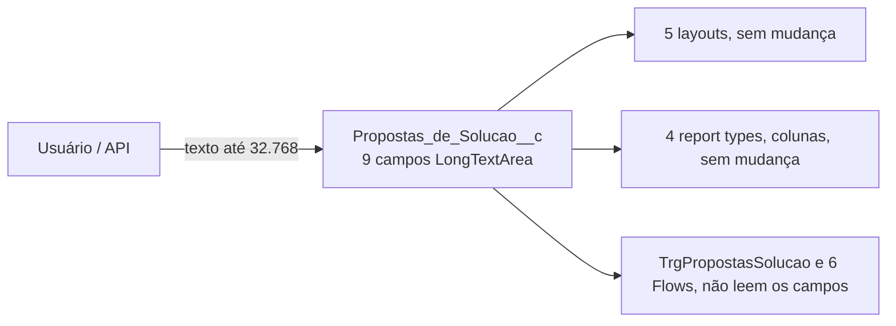

# Documento técnico – SOMOSAGILITY-31: Campos de texto longo em Propostas_de_Solucao__c

**Cliente:** somos-agility · **Versão:** 2026-11-26 · **Design:** `03-design.md` · **Org de construção:** `sbx-somos-agility-dev`

## 1. Resumo
Nove campos de `Propostas_de_Solucao__c` (Cotação, Proposta Acabada e Informações Técnicas Complementares, com sufixos vazio, `_2` e `_3`) são Área de texto de 255 caracteres e o time precisa gravar textos maiores. Solução: alterar o tipo dos 9 campos para Área de texto longo (32.768), mantendo API name, rótulo, descrição, layouts e FLS. Só metadata de campo; sem Flow, sem Apex. Premissa: P1 = (a), ver `03-design.md`.

| Quem | O que faz |
| --- | --- |
| Dev Salesforce (builder) | massa sintética na dev antes do deploy; altera os 9 XML; implanta na dev |
| Verificador | prova CA-01 a CA-09 e o lote de 200 na dev |
| Consultor (produção) | responde P3 e P9; sobe em produção em janela; decide qualquer rollback |

## 2. Contexto na org

| Fato | Onde |
| --- | --- |
| Os 9 campos existem como Área de texto(255), `Length` 255, `IsNillable` true | `FieldDefinition`, dev, 2026-11-26 (esta sessão) |
| XML no repo: `<type>TextArea</type>`, `<required>false</required>`, `trackHistory` e `trackFeedHistory` false; `description` só em `Cotacao__c` e `Proposta_Acabada__c` | `force-app/main/default/objects/Propostas_de_Solucao__c/fields/` |
| Trigger `TrgPropostasSolucao`, 6 Flows after-save ativos, 13 validation rules ativas; nenhum lê os 9 campos | `02-recon.md` seções 3 e 6.1 |
| Referências no repo: 5 layouts, 2 permission sets, 4 report types; nenhuma em Apex, Flow, flexipage, LWC ou fórmula | `02-recon.md` seção 2 e Grep desta sessão |
| `Oportunidade__c` é master-detail para Opportunity; obrigatórios no campo: `Oportunidade__c` e checkboxes | `FieldDefinition`, dev |
| `PslSemOrcamentista` exige `Oportunidade__r.Or_amentista__c` (lookup para Contact) na criação | XML da regra no repo; campo confirmado em `FieldDefinition` |
| Dev: 0 PSL, 0 Opportunity, 0 Account | `SELECT COUNT()`, dev |
| Opportunity: 26 validation rules ativas; Contact: 4; Account: 1 | Tooling `ValidationRule`, dev |
| 7 record types ativos no objeto (`AcabamentoPropostaEnvio`, `CriacaoProposta`, `EspecificaoTecnica`, `MargensCondicoesEspeciais`, `PFPBase`, `Proposta_enviada_ao_cliente`, `Retorno_do_cliente`) | `RecordType`, dev |
| QA: não conectada nesta sessão | — |

## 3. Arquitetura alvo

| Componente | Tipo | Novo, alterado ou nova versão | API name |
| --- | --- | --- | --- |
| Cotação | CustomField | alterado (tipo) | `Propostas_de_Solucao__c.Cotacao__c` |
| Cotação 2 | CustomField | alterado (tipo) | `Propostas_de_Solucao__c.Cotacao_2__c` |
| Cotação 3 | CustomField | alterado (tipo) | `Propostas_de_Solucao__c.Cotacao_3__c` |
| Proposta Acabada | CustomField | alterado (tipo) | `Propostas_de_Solucao__c.Proposta_Acabada__c` |
| Proposta Acabada 2 | CustomField | alterado (tipo) | `Propostas_de_Solucao__c.Proposta_Acabada_2__c` |
| Proposta Acabada 3 | CustomField | alterado (tipo) | `Propostas_de_Solucao__c.Proposta_Acabada_3__c` |
| Informações Técnicas Complementares | CustomField | alterado (tipo) | `Propostas_de_Solucao__c.Informa_es_T_cnicas_Complementares__c` |
| Informações Técnicas Complementares 2 | CustomField | alterado (tipo) | `Propostas_de_Solucao__c.Informa_es_T_cnicas_Complementares_2__c` |
| Informações Técnicas Complementares 3 | CustomField | alterado (tipo) | `Propostas_de_Solucao__c.Informa_es_T_cnicas_Complementares_3__c` |

## 4. Modelo de dados e acesso
Para os 9 campos, igual para todos:

| Atributo | Antes | Depois |
| --- | --- | --- |
| `type` | `TextArea` | `LongTextArea` |
| `length` | (255 implícito) | `32768` |
| `visibleLines` | — | `5` (premissa P6; o cliente confere na tela) |
| `required` | false | false |
| `label`, `description`, `trackHistory`, `trackFeedHistory`, `trackTrending` | atual | **inalterados** (copiar do retrieve da dev, não do repo) |
| Chave externa, único, valores | não se aplica | não se aplica |

Acesso: sem mudança. Quem lê e edita hoje continua (FLS em perfis e nos permission sets `Acesso_completo_Esteira_de_vendas_e_renovacoes` e `DiretorComercial`). O pacote não leva perfil nem permission set. Efeito do tipo longo: o campo deixa de ser usável em filtro de relatório, list view, `WHERE` de SOQL e fórmula.

## 5. Lógica e automações
Não há lógica nova. Automações do objeto no mesmo evento (trigger `TrgPropostasSolucao` before/after insert, update, delete, undelete; 6 Flows after-save; 13 validation rules) não referenciam os campos e não mudam. Nenhum Flow ou classe recebe versão nova; não há passo de ativação.

## 6. Integrações
Não há integração nesta demanda. Se a SnapERP ou um template (Conga, SDocs) ler os campos, isso aparece na resposta a P3 e vira demanda própria.

## 7. Dados: carga, migração e configuração
Não há carga nem dado de configuração. Valores existentes (até 255) são preservados pela plataforma na troca de tipo.

Massa sintética de teste (dev antes do deploy; QA depois do deploy), prefixo `TESTE SOMOSAGILITY-31`, valores fictícios:
1. Account: Name `TESTE SOMOSAGILITY-31 Conta`.
2. Contact: LastName `TESTE SOMOSAGILITY-31 Orcamentista`, AccountId da conta de teste.
3. Opportunity: Name `TESTE SOMOSAGILITY-31 Opp`, AccountId, StageName = primeiro valor ativo do processo padrão, CloseDate = hoje + 30, `Or_amentista__c` = Contact de teste, `Conversao_de_Lead__c` = `Não`. Se uma das 26 validation rules ativas recusar, ler a mensagem, preencher o campo pedido com valor fictício e registrar no plano de build (receita da SOMOSAGILITY-26).
4. PSL: `Oportunidade__c` = Opp de teste; `PFP_1_Fechada__c`, `PFP_2_Fechada__c`, `PFP_3_Fechada__c` e `Proposta_Fechada_pelo_Cliente__c` = false; `StatusPsl__c` e `Status_da_PSL__c` no padrão; `ResponsavelEnvioProposta__c` diferente de `Inside Sales`. Com isso as 13 regras ativas do objeto não disparam (fórmulas lidas no repo: CNPJ só com PFP fechada; M01/M02/M05 só com PFP ou PSL fechada; M04 por contagem de PSL fechada; contato e data só em status específicos; `PslSemOrcamentista` atendida pelo Orçamentista).
5. Texto sintético: `'A'.repeat(n)` ou equivalente gerado no próprio Apex anônimo; nunca dado copiado de registro.
6. Para a prova de lote: 200 PSL na mesma Opportunity de teste.

Limpeza: apagar PSL, Opportunity, Contact e Account com o prefixo no fim da sessão; conferir por `COUNT()`.

## 8. Plano de testes

| # | Cenário | Esperado | Critério |
| --- | --- | --- | --- |
| 1 | `FieldDefinition` dos 9 campos | Área de texto longo, 32768 | CA-01 |
| 2 | PSL criada antes do deploy com `Cotacao__c` de 255 caracteres; ler depois | `len=255`, `iguais=true` | CA-02 |
| 3 | Gravar 32.768 em `Proposta_Acabada_2__c` | salva, `len=32768` | CA-03 |
| 4 | Gravar 32.769 em `Informa_es_T_cnicas_Complementares_3__c` | `STRING_TOO_LONG`, campo inalterado | CA-04 |
| 5 | Salvar PSL com `Cotacao__c` vazio | salva | CA-05 |
| 6 | `FieldPermissions` por campo (contagem de leitura e edição) antes e depois | iguais | CA-06 |
| 7 | Conteúdo do PR / `05-deploy-qa.md` | só os 9 `CustomField` | CA-07 |
| 8 | Retrieve dos 5 layouts antes e depois | sem diferença | CA-08 |
| 9 | Deploy; contagem de validation rules ativas (13) e Flows ativos (6) do objeto | deploy sem erro, contagens iguais | CA-09 |
| 10 | Template ou relatório de P3 com PSL de teste acima de 255 | texto completo | CA-10 (só se P3 listar) |
| 11 | Regressão: update em lote de 200 PSL com `Cotacao__c` em 32.768 | sucesso, sem erro de heap | seção 4 do design |
| 12 | Regressão na QA: contagem agregada por campo de PSL com valor maior que 255 logo após o deploy | 0 | CA-02 (QA) |

Toda saída de teste é número (`len`, contagem, `true/false`) ou código de erro; nenhum valor de registro real é lido.

## 9. Implantação e rollback
1. Dev: massa sintética (PR-1) → retrieve dos 9 campos e dos 5 layouts (base) → editar os 9 XML → deploy dos 9 `CustomField` → provas 1 a 9 e 11 → limpeza.
2. QA: a esteira implanta os 9 campos (`05-deploy-qa.md`) → QA confere no `05-deploy-qa.md` que só os 9 campos subiram e roda 1, 3 a 9 e 12 com massa própria (antes × depois não é comparável na QA) → limpeza.
3. Produção (consultor, fora da esteira): responder P3 antes; deploy dos 9 `CustomField` em janela (P9); conferir `FieldDefinition` e abrir uma PSL na tela.

| Passo | Como desfazer |
| --- | --- |
| Deploy dos 9 campos (dev, QA) | reimplantar o XML anterior (`TextArea`) enquanto nenhum valor passar de 255 |
| Deploy dos 9 campos (produção) | só com decisão do cliente: exportar antes os valores dos 9 campos (consultor) e aceitar o truncamento acima de 255 ao voltar para `TextArea` |
| Massa de teste | apagar pelo prefixo |

## 10. Responsabilidades, premissas e riscos
- [x] Objeto é `Propostas_de_Solucao__c` (comentário do card, 2026-11-26 12:15).
- [x] Campos não obrigatórios (`IsNillable` true na dev; P7).
- [ ] Alterar o tipo, não criar campos (P1, aceite do gate).
- [ ] QA e produção com o mesmo tipo (P2, sem confirmação).
- [ ] Nenhum consumidor fora do repo filtra ou trunca os campos (P3, sem confirmação).
- [ ] FLS igual à de hoje (P5, premissa).
- [ ] 32.768 e 5 linhas visíveis (P6, premissa).
- [ ] Sem carga (P8, premissa).
- Riscos: rollback em produção trunca acima de 255 (exportar antes, decisão do cliente); consumidor não levantado quebra com filtro (P3 e "Onde é usado" na QA); heap em lote com campos cheios (prova de 200, teto de lote se falhar); massa de teste barrada por validation rule da Opportunity (receita da 26, falha de ambiente se for regra só da QA).
